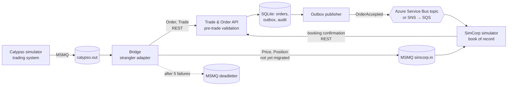

# TradeFlow: MSMQ to API modernization for a trading flow

TradeFlow recreates a legacy trading integration, **Calypso → MSMQ → SimCorp** (orders, trades, prices,
positions), and modernizes it step by step into an **API-driven, event-based design** on .NET 10, using either
**Azure Service Bus** or **AWS SNS/SQS**.

## Architecture



| Project | Role |
|---|---|
| `TradeFlow.CalypsoSimulator` | Writes orders, trades, prices and positions to MSMQ, exactly like the legacy system. Sends some bad orders and duplicates on purpose. |
| `TradeFlow.Bridge` | Strangler-fig adapter. Reads the legacy queue inside an MSMQ transaction. Migrated message types go to the API; the rest still go to SimCorp's legacy queue. Failed hand-offs are retried, then dead-lettered. |
| `TradeFlow.Api` | ASP.NET Core minimal API. Pre-trade validation, idempotency, transactional outbox, audit trail, booking confirmation and reconciliation endpoints. |
| `TradeFlow.Messaging` | One interface over **Azure Service Bus**, **AWS SNS/SQS**, a local folder bus (no cloud needed) and an in-memory bus for tests. |
| `TradeFlow.Legacy` | MSMQ (via `MSMQ.Messaging`) with transactional queues, plus a folder-based stand-in for machines without MSMQ. |
| `TradeFlow.SimCorpSimulator` | Consumes `OrderAccepted` events from the bus, books the trade and confirms back to the API. Also still reads the legacy MSMQ feed. |
| `TradeFlow.Fix` / `TradeFlow.FixGateway` / `TradeFlow.BrokerSimulator` | FIX 4.4 order routing to a simulated broker (see below). |
| `TradeFlow.Tests` | xUnit unit tests and API integration tests (`WebApplicationFactory`). |

## Pre-trade validation (`POST /api/orders`)

* Instrument exists in reference data, and currency matches the instrument
* **Fat-finger check:** price within 10% of the reference price
* **Notional limit** per portfolio (bonds priced per 100 of face value)
* Quantity and price are positive, trade time isn't in the future, message type is Order or Trade
* **Idempotency:** unique on `SourceSystem + ClientOrderId`. A redelivered order returns the original result.

Responses are `202 Accepted` (with a Location header), `200` for a duplicate, and `422` with reasons for a rejection.
Rejections are stored and audited as well.

## Reliability and controls

* **No message loss on the legacy side:** the MSMQ receive and the API call share one MSMQ transaction. If the API is down, the message goes back on the queue.
* **Transactional outbox:** the order, its audit entry and the event are saved in one database transaction. A background publisher sends events at least once, and consumers are idempotent.
* **Dead-letter queues:** MSMQ dead-letter queue on the bridge, Service Bus `max-delivery-count 5`, SQS redrive policy, and a dead-letter folder for the local bus.
* **Audit trail:** every state change (`Rejected`, `Accepted`, `Published`, `Booked`) with a timestamp and one **correlation ID** carried from Calypso to SimCorp (`X-Correlation-ID`).
* **Reconciliation:** `GET /api/reconciliation` counts accepted, published and booked orders, and lists breaks (orders not booked within 60 seconds).

## Run it

Prerequisites: .NET 10 SDK and Visual Studio 2026 (or the `dotnet` CLI).

1. **MSMQ:** in an Administrator PowerShell run `scripts\enable-msmq.ps1`.
   If MSMQ isn't available on your PC, set `"Transport": "File"` in `tradeflow.shared.json`.
2. **Start everything:** run `scripts\run-local.ps1`, or in Visual Studio choose **Configure Startup Projects → Multiple**
   and start Api, SimCorpSimulator, Bridge and CalypsoSimulator.
3. Watch the windows: Calypso sends, Bridge routes, the API accepts or rejects, SimCorp books.
4. Open `http://localhost:5080/api/reconciliation`, or use `src/TradeFlow.Api/TradeFlow.Api.http` in Visual Studio.

All shared settings live in **`tradeflow.shared.json`** at the solution root and are copied to every project.

### Switch the modern side to the cloud

| Provider | Setup | Setting |
|---|---|---|
| Local (default) | none | `"Provider": "LocalFile"` |
| Azure Service Bus | `scripts\setup-azure.ps1` (stores the connection string in the user environment variable `Messaging__AzureServiceBus__ConnectionString`) | `"Provider": "AzureServiceBus"` |
| AWS SNS + SQS | `aws configure`, then `scripts\setup-aws.ps1`, and paste TopicArn and QueueUrl into the shared file | `"Provider": "Aws"` |

### Demo the migration story

* `Bridge:MigratedTypes` = `Order,Trade`: prices and positions still flow over MSMQ to SimCorp (watch the "Legacy path" log lines).
* Change it to `Order,Trade,Price,Position` to see everything leave the legacy path. That's the final cut-over step.
* Stop the API while Calypso is running: messages wait in MSMQ, and nothing is lost when the API comes back.
* Set `SimCorp:FailureRate` to `0.3` to see retries and dead-lettering on the bus.

## Tests and CI

```
dotnet test TradeFlow.slnx
```

Pipelines are included for **GitHub Actions** (`.github/workflows/ci.yml`) and **Azure DevOps** (`azure-pipelines.yml`).
They run with the File and InMemory transports, so they don't need MSMQ or the cloud.

## FIX order routing

Orders (not yet executed) go to a broker over **FIX 4.4** before SimCorp books them; trades (already executed) are booked directly.

```
API --OrderAccepted--> bus --(subscription fix-gateway)--> FIX Gateway --NewOrderSingle 35=D--> Broker simulator
Broker --ExecutionReport 35=8 (New, partial fills, Filled / Rejected)--> FIX Gateway --REST--> API /executions
API (Filled) --OrderFilled--> bus --(subscription simcorp)--> SimCorp books the fill
```

* `TradeFlow.Fix`: a small FIX 4.4 engine: tag=value codec with BodyLength (9) and CheckSum (10), TCP framing, Logon (A) with
  ResetSeqNumFlag, Heartbeat (0) / TestRequest (1), sequence-number checks, and every message logged as `8=FIX.4.4|9=..|35=D|...`.
* `TradeFlow.FixGateway`: FIX initiator (`TRADEFLOW` -> `BROKER`, port 9878). ClOrdID (11) = API order ID, so fills map back with no state.
* `TradeFlow.BrokerSimulator`: FIX acceptor. Acknowledges (150=0), fills in 1-3 executions at or better than the limit, rejects about 5%.
* Order statuses: `Accepted -> Published -> SentToBroker -> PartiallyFilled -> Filled -> Booked` (or `BrokerRejected`).
* `GET /api/orders/{id}/executions` lists every fill. Turn routing off with `Routing:OrdersViaFix = false`.

## Next phase

* Replace the hand-written FIX engine with QuickFIX/n (persistent message store, resend requests) for production
* OpenTelemetry tracing across the bridge, API and bus
* SQL Server / Azure SQL provider and EF Core migrations instead of `EnsureCreated`
* Containerize and deploy the API (Azure App Service or AWS ECS)
